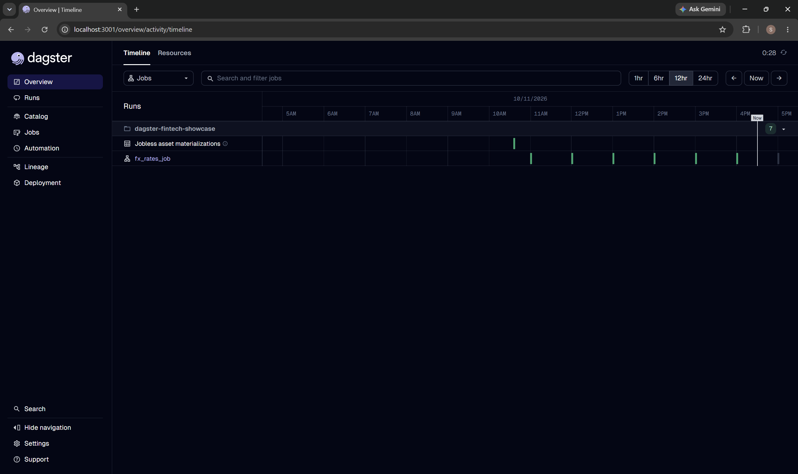
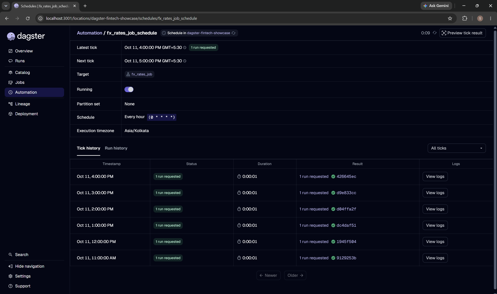
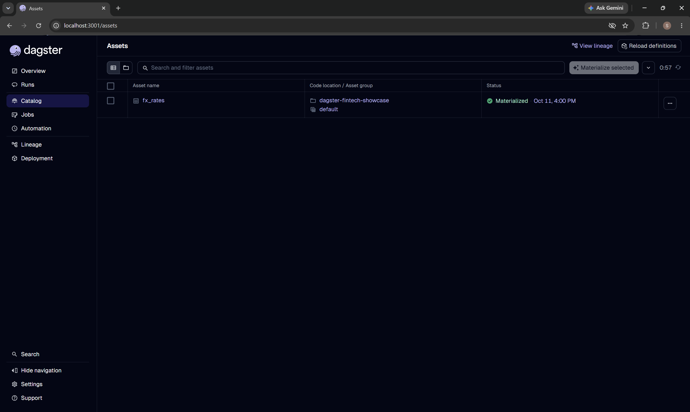
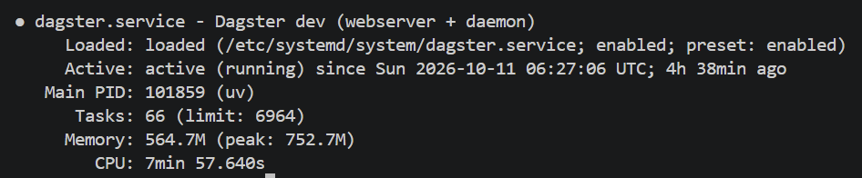

# Dagster Market Data Pipeline

An automated market-data pipeline built with [Dagster](https://dagster.io), running **24/7 on a free Oracle Cloud VM** with no laptop involved.

Every hour, Dagster fetches the **USD/INR exchange rate** and the **Bitcoin (BTC/USD) price** and appends one row to a CSV file.



## What this demonstrates

- **Asset-based orchestration**: `fx_rates` is a Dagster asset that fetches two public APIs and records the result with run metadata.
- **Schedule automation**: an hourly cron schedule (`0 * * * *`, Asia/Kolkata) launches the job with nobody clicking anything.
- **Real deployment**: the Dagster webserver and daemon run as a `systemd` service on an Oracle Cloud Always Free ARM VM (Ubuntu 24.04), so it keeps running when my laptop is off and restarts automatically after a crash or reboot.
- **Reproducible environment**: dependencies are pinned in `uv.lock`; one command rebuilds the environment on any machine.

## Proof that it runs on its own

My laptop was shut down while the server collected data. Rows below are real output from the server (`docs/sample_rates.csv`). Times are UTC; IST is +5:30.

| Fetched at (UTC) | IST | Source |
|---|---|---|
| 05:05 | 10:35 | Manual test run |
| 05:30 | 11:00 | Scheduled by the server |
| 06:30 | 12:00 | Scheduled by the server |
| 07:30 | 13:00 | Scheduled by the server |
| 08:30 | 14:00 | Scheduled by the server |
| 09:30 | 15:00 | Scheduled by the server |
| 10:30 | 16:00 | Scheduled by the server |

BTC changes between rows. USD/INR stays flat during the day because the source publishes one reference rate per working day.

## Screenshots

### Schedule and tick history: six hourly ticks, each launched a run


### The asset after its latest scheduled run


### Dagster running as a systemd service on the Oracle VM


## Architecture

```
            hourly cron tick
  Scheduler daemon ─────────────► fx_rates_job ──► fx_rates asset
  (Dagster, on Oracle VM)                              │
                                                       ├─► Frankfurter API  (USD/INR)
                                                       ├─► CoinGecko API    (BTC/USD)
                                                       └─► data/rates.csv   (append one row)
```

| Piece | Role |
|---|---|
| Asset `fx_rates` | The data to produce: fetches both APIs, appends a row, records metadata |
| Job `fx_rates_job` | Selects which assets to run |
| Schedule `fx_rates_job_schedule` | Decides when: every hour |
| Daemon | Background process that evaluates schedules and launches runs |

## Project layout

```
src/dagster_fintech_showcase/
├── definitions.py        # Dagster entry point
└── defs/
    ├── assets.py         # fx_rates asset
    └── schedules.py      # job + hourly schedule
docs/
├── runs.png              # run timeline
├── ticks.png             # schedule tick history
├── asset.png             # asset after a scheduled run
├── server.png            # systemd service status on the VM
└── sample_rates.csv      # real output from the server
```

## Run it locally

Requirements: Python 3.9+, [uv](https://docs.astral.sh/uv/), git.

```bash
git clone https://github.com/Sahaj7102/dagster-market-data-pipeline.git
cd dagster-market-data-pipeline
uv sync
uv run dg dev
```

Open http://localhost:3000. The schedule starts switched on. Click **Materialize** on `fx_rates` to run it once by hand. Output lands in `data/rates.csv`.

## Deploy it on Oracle Cloud (Always Free)

1. Create a VM: Ubuntu 24.04, shape `VM.Standard.A1.Flex` (Always Free-eligible), 1 OCPU, 6 GB RAM, with your SSH public key, and assign it a public IP.
2. On the VM, install git and uv, then clone and build:
   ```bash
   sudo apt update && sudo apt install -y git curl
   curl -LsSf https://astral.sh/uv/install.sh | sh
   git clone https://github.com/Sahaj7102/dagster-market-data-pipeline.git
   cd dagster-market-data-pipeline && uv sync
   mkdir -p ~/dagster_home
   ```
3. Create `/etc/systemd/system/dagster.service`:
   ```ini
   [Unit]
   Description=Dagster dev (webserver + daemon)
   After=network-online.target
   Wants=network-online.target

   [Service]
   User=ubuntu
   WorkingDirectory=/home/ubuntu/dagster-market-data-pipeline
   Environment=DAGSTER_HOME=/home/ubuntu/dagster_home
   ExecStart=/home/ubuntu/.local/bin/uv run dg dev
   Restart=always
   RestartSec=10

   [Install]
   WantedBy=multi-user.target
   ```
4. Start it and enable it at boot:
   ```bash
   sudo systemctl daemon-reload
   sudo systemctl enable --now dagster
   ```
5. View the UI without exposing it to the internet, using an SSH tunnel:
   ```bash
   ssh -i ~/.ssh/<your_key> -L 3001:localhost:3000 ubuntu@<vm-public-ip>
   ```
   Then open http://localhost:3001.

## Honest limitations

- **Dev-mode deployment.** The service runs `dg dev`, which is meant for development. A production setup would run `dagster-webserver` and `dagster-daemon` separately, with Postgres for run storage.
- **Single node, CSV storage.** Fine for a demo, not for high-volume data.
- **USD/INR is daily.** Frankfurter publishes one rate per working day, so hourly polling repeats the value.
- **Missed ticks are not recoverable.** BTC price is a live snapshot, so a tick missed during an outage cannot be backfilled.
- **Free-tier terms can change.** Oracle's Always Free offer and capacity are not guaranteed.
- **Ephemeral public IP.** It can change if the VM is stopped and started.

## Next steps

- `daily_average` asset with declarative automation (`AutomationCondition.eager()`)
- Asset checks (rate must be positive and not null)
- Postgres storage and a production-style deployment

## Data sources

- [Frankfurter](https://frankfurter.dev): ECB reference exchange rates
- [CoinGecko](https://www.coingecko.com): crypto prices (free tier)
